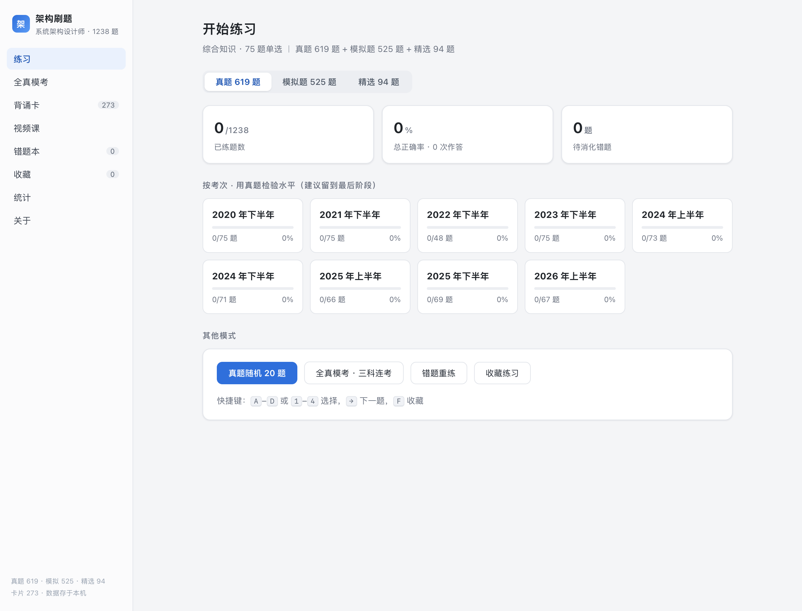
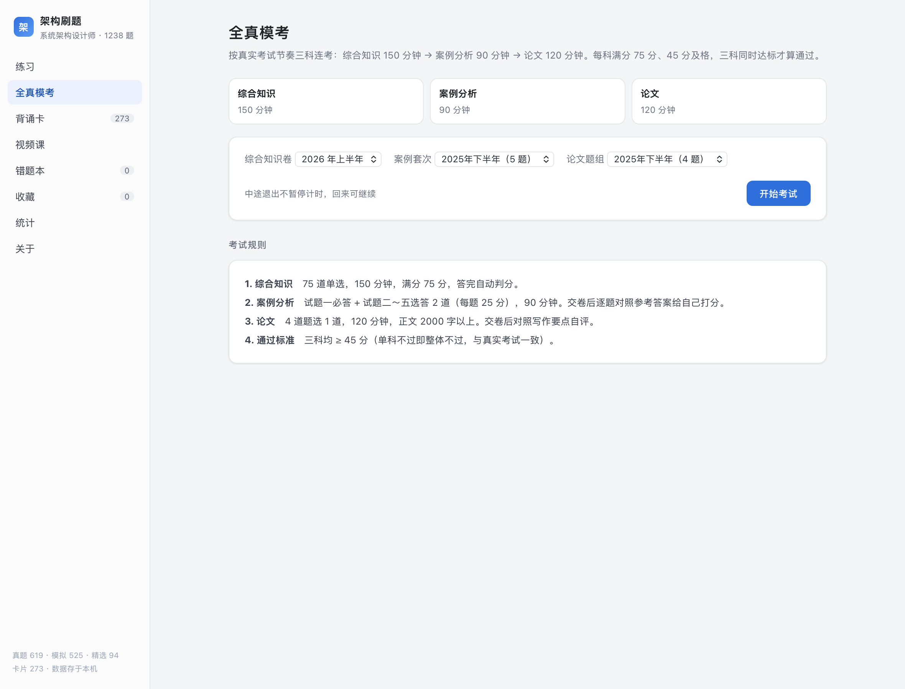
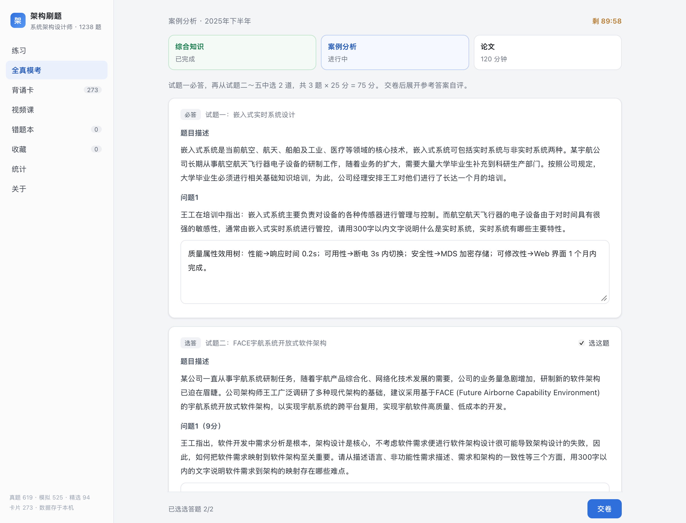
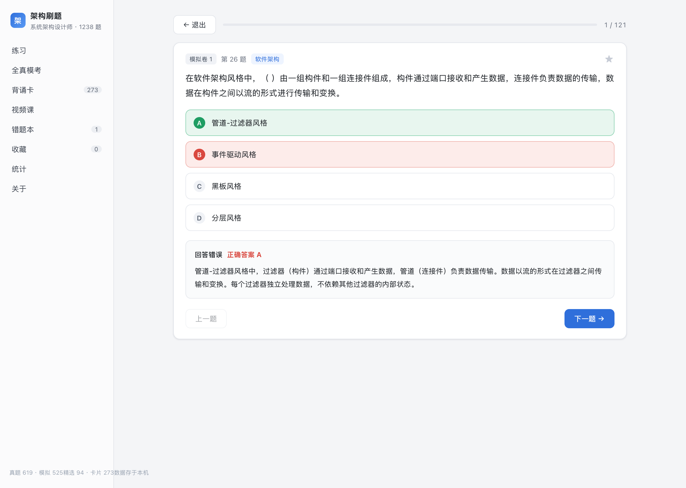

# 架构刷题 · 系统架构设计师

> 软考高级「系统架构设计师」的本地刷题工具。真题 + 模拟题 + 高频精选 + 案例/论文背诵卡 + **全真三科模考** + 视频课入口，装成 macOS App 用，也可直接用浏览器打开。
>
> **纯离线、无账号、无联网上报**，答题记录只写在本机。

面向 **2027 年上半年（5 月）** 备考整理。三科同考、均需 ≥45 分，所以刷题、案例、论文、模考四块都做了对应模块。



## 功能

| 模块 | 说明 |
| --- | --- |
| **真题练习** | 619 道综合知识单选，覆盖 2020 下半年 – 2026 上半年共 9 套，每题带答案与解析 |
| **模拟题练习** | 525 道社区原创模拟题（7 套模拟卷），按 10 个考点归类，可单考点突破 |
| **高频精选** | 94 道按章节归类的经典题，逐题带详细解析，适合真题刷完查漏 |
| **全真模考** | 按真实节奏三科连考：综合知识 150 分钟 → 案例分析 90 分钟 → 论文 120 分钟，每科 75 分、45 分及格，三科同时达标才算过 |
| **背诵卡** | 273 张四套牌组：真题案例 38 / 真题论文 32 / 案例提炼 110 / 论文提炼与范文 93。「看题 → 自己口述 → 对照踩分点自评」，Leitner 三盒间隔复习 |
| **错题本 / 收藏 / 统计** | 自动记录作答，错题可反复刷；按年份、考点看正确率 |
| **导出** | 错题一键导出 Anki（txt，可直接导入）或 Word（.docx），方便二刷 |
| **多空题处理** | 一组选项一个空的多空题按组对位自动判分；选项与答案无法一一对应的才提示手动评分 |
| **视频课入口** | 按章节对应 B 站 / 希赛公开课，App 内嵌官方播放器，不缓存不下载 |

## 截图

| 全真模考 · 科目与规则 | 案例分析 · 边答边存 |
| --- | --- |
|  |  |

| 答题解析 | 背诵卡 |
| --- | --- |
|  |  |

| 视频课 | 赞赏 |
| --- | --- |
|  |  |

## 快速开始

### 方式一：浏览器直接打开（最快）

```bash
git clone <this-repo> arch-quiz && cd arch-quiz
python3 tools/build.py        # 用仓库自带的 demo 数据生成 app/index.html
open app/index.html
```

仓库自带 `app/data/demo.json`，够看效果，不够刷题。

### 方式二：拉全量题库（推荐）

题库不在仓库里（版权原因，见下文），用脚本从公开仓库抓取并解析：

```bash
python3 tools/fetch_bank.py   # 输出 app/data/bank.json（约 1.4 MB）
python3 tools/build.py        # 注入后生成 app/index.html
```

`fetch_bank.py` 只读公开的 Markdown 文本，逐文件下载、失败自动重试，全程约 1–3 分钟。抓完会打印每套卷的题目数，方便对账。

### 方式三：打包成 macOS App

```bash
./build.sh                      # 产出 build/架构刷题.app
cp -R build/架构刷题.app /Applications/
```

只需要 Xcode 命令行工具（`xcode-select --install`），不需要 Xcode 本体、不需要开发者账号。首次打开若被拦截：右键 →「打开」。`./build.sh web` 可以只生成网页。

### 方式四：导入自己的讲义（可选）

手里有还没进题库的资料（图片型 PDF 也行），可以自己 OCR 成题库/卡片：

```bash
swiftc -O tools/ocr_pdf.swift -o /tmp/ocr_pdf
/tmp/ocr_pdf 讲义.pdf /tmp/ocr.json

# 带答案与解析的选择题
python3 tools/import_material.py choice /tmp/ocr.json --out app/data/high.json --year 精选100

# 案例/论文要点、论文范文 → 背诵卡
python3 tools/import_material.py cards /tmp/ocr.json --kind cf --label 案例提炼 --out app/data/cards_extra.json
python3 tools/import_material.py cards /tmp/ocr.json --kind pf --label 论文范文 --mode essay --out app/data/cards_extra.json

python3 tools/build.py
```

导入时会按关键词剔除页眉、页脚、水印、机构名与联系方式，所以卡片里不会残留第三方标识。**原 PDF 与解析结果都只留在本地，不要提交进仓库。**

## 全真模考怎么算分

| 科目 | 时长 | 题量 | 判分方式 |
| --- | --- | --- | --- |
| 综合知识 | 150 分钟 | 75 题单选 | 自动判分，按 75 题折算 75 分 |
| 案例分析 | 90 分钟 | 试题一必答 + 试题二～五选 2（每题 25 分） | 交卷后展开参考答案，逐题自评 0–25 |
| 论文 | 120 分钟 | 4 题选 1，正文 2000 字以上 | 交卷后对照写作要点自评 0–75 |

三科均 ≥45 分才判「通过」，与真实考试规则一致。计时不因退出而暂停，回来自动续上；时间到自动交卷进入下一科。

案例与论文的分数是**自评**，用来定位差距，不等于阅卷结果。

## 目录结构

```
arch-quiz/
├── app/
│   ├── src/
│   │   ├── index.tpl.html   # 单页应用源码（HTML+CSS+JS，无框架无依赖）
│   │   ├── main.swift       # WKWebView 外壳 + 本地存储/导出桥接
│   │   ├── docx.swift       # 最小 OOXML 生成器（导出 Word 用）
│   │   └── icon.png         # 1024×1024 图标
│   ├── data/demo.json       # 演示题库（仓库自带）
│   └── index.html           # 构建产物，被 App 与浏览器共用
├── tools/
│   ├── fetch_bank.py        # 抓取 + 解析在线题库
│   ├── import_material.py   # 解析本地讲义的 OCR 结果
│   ├── ocr_pdf.swift        # PDF → OCR JSON（系统 Vision，离线）
│   ├── build.py             # 题库注入模板
│   └── push_github.py       # 维护者用：无 git 协议时走 API 推送
├── docs/数据来源与版权说明.md
├── assets/                  # 赞赏码
├── screenshots/
└── build.sh
```

架构很土但够用：整个 App 就是**一个 HTML 文件 + 一层原生壳**。

- 数据只存本机：Swift 侧把 `localStorage` 的读写接到 `~/Library/Application Support/JiaGouShuaTi/progress.json`，浏览器里则回落到 `localStorage`；
- 导出走 `NSSavePanel`，不申请录音、网络等任何隐私权限。

## 数据来源与边界

**不是官方发布，也没有官方授权。** 题目原文来自社区整理的公开仓库（`wujiaming88/awesome-ruankao`），本仓库只提供解析脚本，不附带题库内容。已知缺口：

- **2022 下半年只有 48 题**（原文档缺 27 题的选项），不是 75 题；
- 少数题目选项与答案无法一一对应（多空题共用选项），App 里标注并改为手动评分；
- **背诵卡**：真题部分 85 张里有 15 张原文没有参考答案，已排除；
- 答案与解析均为第三方整理，**可能有错**。做题时以教材/官方答案为最终依据。

详见 [`docs/数据来源与版权说明.md`](docs/数据来源与版权说明.md)。

## 赞赏

如果这个工具帮你省了点时间，可以请我喝杯咖啡。**完全自愿，与任何功能无关**，不打赏也一切照旧。

<p>
  
  
</p>

赞赏仅代表个人心意，不构成任何商品或服务交易，也不附带任何答疑/资料承诺。

## 免责声明

- 本项目与工业和信息化部、中国计算机技术职业资格网（ruankao.org.cn）**无任何关系**；
- 题目、答案、解析的著作权归原命题机构及整理者所有，本项目仅做个人备考用途的格式转换；
- 视频课以**外链 / 官方播放器**方式引用（B 站、希赛网），本项目不存储、不转码、不分发任何视频内容，版权归各平台及讲师所有；
- 使用本项目产生的备考结果由使用者自行承担。

## License

代码以 [MIT](LICENSE) 授权。题库内容不在授权范围内。
