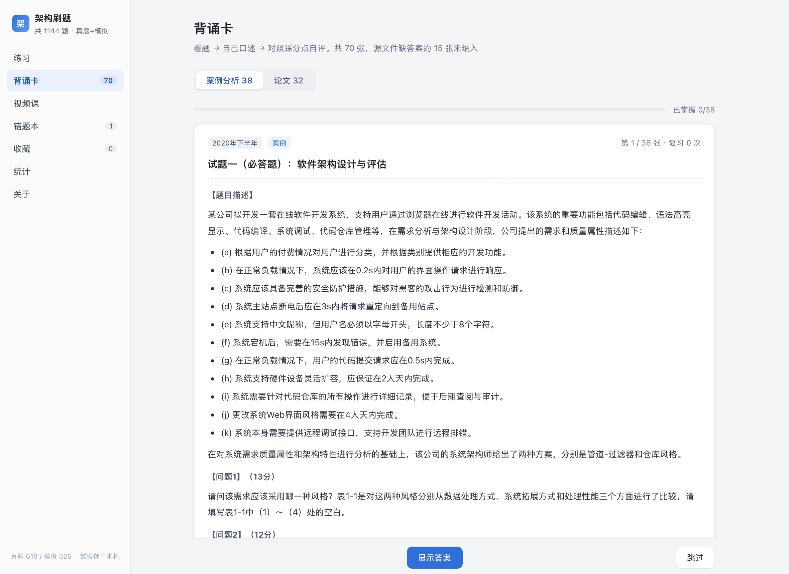
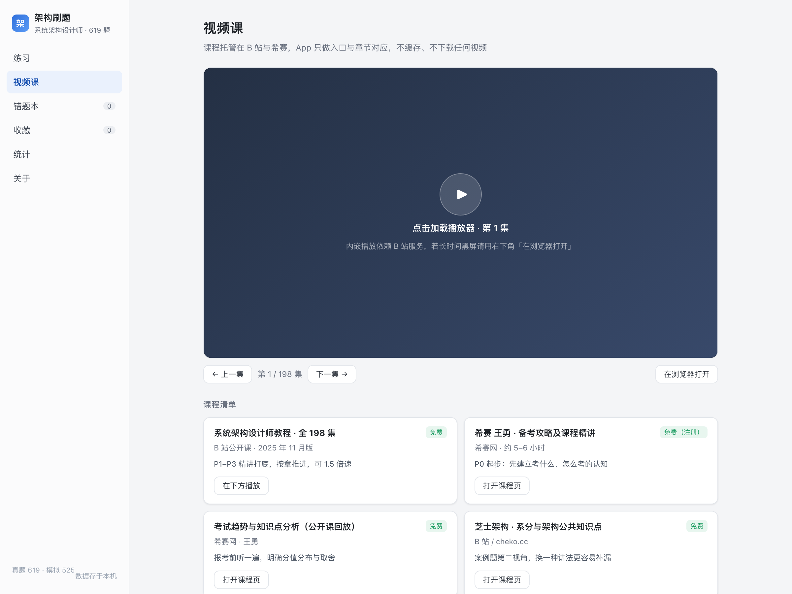
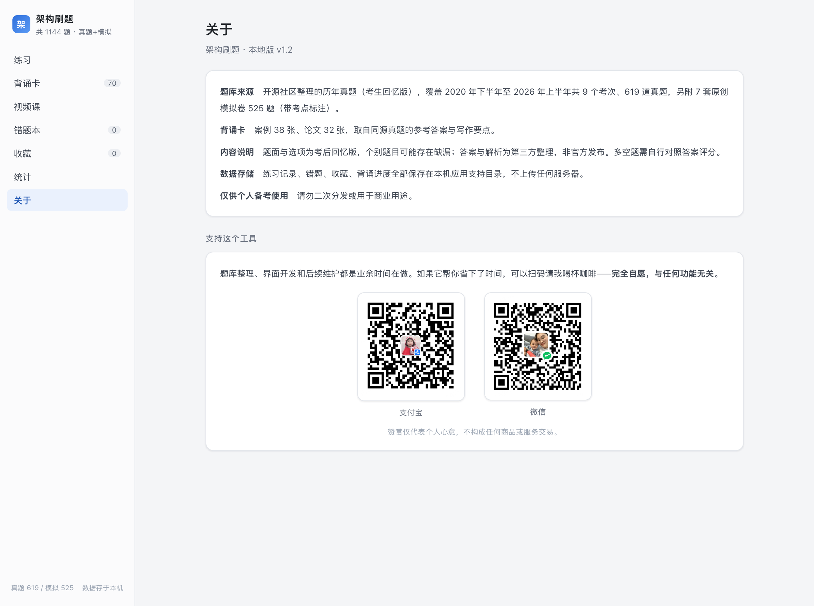

# 架构刷题 · 系统架构设计师

> 软考高级「系统架构设计师」的本地刷题工具。真题 + 模拟题 + 案例/论文背诵卡 + 视频课入口，装成 macOS App 用，也可直接用浏览器打开。
>
> **纯离线、无账号、无联网上报**，答题记录只写在本机。

面向 **2027 年上半年（5 月）** 备考整理。三科同考、均需 ≥45 分，所以刷题、案例、论文三块都做了对应模块。


## 功能

| 模块 | 说明 |
| --- | --- |
| **真题练习** | 619 道综合知识单选，覆盖 2020 下半年 – 2026 上半年共 9 套，每题带答案与解析 |
| **模拟题练习** | 525 道社区原创模拟题（7 套模拟卷），按 10 个考点归类，可单考点突破 |
| **整卷模考** | 75 题 / 150 分钟倒计时，交卷后出分、逐题复盘 |
| **背诵卡** | 70 张（案例分析 38 / 论文 32）：「看题 → 自己口述 → 对照踩分点自评」，按 Leitner 三盒间隔复习 |
| **错题本 / 收藏 / 统计** | 自动记录作答，错题可反复刷；按年份、考点看正确率 |
| **导出** | 错题一键导出 Anki（txt，可直接导入）或 Word（.docx），方便二刷 |
| **视频课入口** | 按章节对应 B 站 / 希赛公开课，App 内嵌播放，不缓存不下载 |

## 截图

| 答题解析 | 背诵卡 |
| --- | --- |
|  |  |

| 视频课 | 赞赏 |
| --- | --- |
|  |  |

## 快速开始

### 方式一：浏览器直接打开（最快）

```bash
git clone <this-repo> arch-quiz && cd arch-quiz
python3 tools/build.py        # 用仓库自带的 demo 数据生成 app/index.html
open app/index.html
```

仓库自带 `app/data/demo.json`（54 真题 + 15 模拟 + 20 卡片），够看效果，不够刷题。

### 方式二：拉全量题库（推荐）

题库不在仓库里（版权原因，见下文），用脚本从公开仓库抓取并解析：

```bash
python3 tools/fetch_bank.py   # 输出 app/data/bank.json（约 1.4 MB）
python3 tools/build.py        # 注入后生成 app/index.html
```

`fetch_bank.py` 只读公开的 Markdown 文本，逐文件下载、失败自动重试，全程约 1–3 分钟（视网速）。抓完会打印每套卷的题目数，方便对账：

```
真题 2020下: 75 题
真题 2022下: 48 题
...
模拟 模拟1: 75 题
完成：真题 619 / 模拟 525 / 卡片 85
```

### 方式三：打包成 macOS App

```bash
./build.sh                      # 产出 build/架构刷题.app
cp -R build/架构刷题.app /Applications/
```

只需要 Xcode 命令行工具（`xcode-select --install`），不需要 Xcode 本体、不需要开发者账号。首次打开若被拦截：右键 →「打开」。

`./build.sh web` 可以只生成网页，不编译 App。

## 目录结构

```
arch-quiz/
├── app/
│   ├── src/
│   │   ├── index.tpl.html   # 单页应用源码（HTML+CSS+JS，无框架无依赖）
│   │   ├── main.swift       # WKWebView 外壳 + 本地存储/导出桥接
│   │   ├── docx.swift       # 最小 OOXML 生成器（导出 Word 用）
│   │   └── icon.png         # 1024×1024 图标
│   ├── data/demo.json       # 演示题库（仓库自带）
│   └── index.html           # 构建产物，被 App 与浏览器共用
├── tools/
│   ├── fetch_bank.py        # 抓取 + 解析题库
│   └── build.py             # 题库注入模板
├── docs/数据来源与版权说明.md
├── assets/                  # 赞赏码
├── screenshots/
└── build.sh
```

架构很土但够用：整个 App 就是**一个 HTML 文件 + 一层原生壳**。

- 数据只存本机：Swift 侧把 `localStorage` 的读写接到 `~/Library/Application Support/JiaGouShuaTi/progress.json`，浏览器里则回落到 `localStorage`；
- 导出走 `NSSavePanel`，录音/联网权限一概不需要（App 沙箱外、无网络请求）。

## 数据来源与边界

**不是官方发布，也没有官方授权。** 题目原文来自社区整理的公开仓库（`wujiaming88/awesome-ruankao`），本仓库只提供解析脚本，不附带题库内容。已知缺口：

- **2022 下半年只有 48 题**（原文档缺 27 题的选项），不是 75 题；
- **25 道「多空题」**（一题干多个空、共用一组选项）在原文里选项与答案不是一一对应，App 里单独标注「多空题请自行对照答案评分」，不参与自动判分；
- **背诵卡 85 张里有 15 张原文没有参考答案**，直接排除不显示，所以可用 70 张；
- 答案与解析均为社区整理，**可能有错**。做题时以教材/官方答案为最终依据，遇到疑问建议回原文核对。

详见 [`docs/数据来源与版权说明.md`](docs/数据来源与版权说明.md)。

## 赞赏

如果这个工具帮你省了点时间，可以请我喝杯咖啡。**完全自愿，与任何功能无关**，不打赏也一切照旧。

<p>
  
  
</p>

赞赏仅代表个人心意，不构成任何商品或服务交易，也不附带任何答疑/资料承诺。

## 免责声明

- 本项目与工业和信息化部、中国计算机技术职业资格网（ruankao.org.cn）**无任何关系**；
- 题目、答案、解析的著作权归原命题机构及整理者所有，本项目仅做个人备考用途的格式转换；
- 视频课以**外链 / 官方播放器**方式引用（B 站、希赛网），本项目不存储、不转码、不分发任何视频内容，版权归各平台及讲师所有；
- 使用本项目产生的备考结果由使用者自行承担。

## License

代码以 [MIT](LICENSE) 授权。题库内容不在授权范围内。
